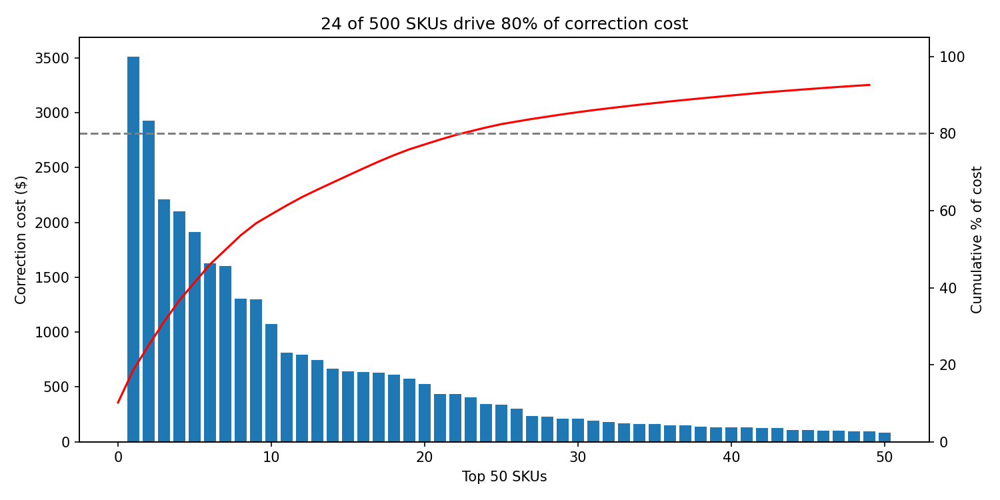

# learn-analytics

Hands-on practice with analytics, SQL, and optimization in Python, built around
supply-chain problems.

## Exercise 1: Pareto analysis of shipping corrections

**Question:** when carriers re-measure parcels and bill extra ("dimensional
corrections"), are the costs spread evenly across products, or concentrated in a few?

**Finding:** concentrated. Across 500 SKUs and 20,000 parcels
(**$34,497.49** in total corrections):

| Share of correction cost | SKUs needed | % of all SKUs |
|---|---|---|
| 50% | 9 | 1.8% |
| 80% | 24 | 4.8% |

Fixing the item-master data for a couple dozen SKUs would remove most of the cost.



**Skills practiced:** pandas (`groupby`, `sort_values`, `cumsum`), matplotlib
(two-axis chart), reproducible scripts with path handling, Git.

> The data is **synthetic**. `src/make_data.py` generates it with a fixed random
> seed, so results are reproducible. It is not real company data.

## Run it yourself

```powershell
pip install pandas numpy matplotlib
python src/make_data.py     # creates data/shipments.csv
python src/pareto.py        # prints the results and saves docs/pareto.png
```

## Project layout

```
data/        generated datasets (not committed)
docs/        charts used in this README
notebooks/   Jupyter exploration
src/         scripts: make_data.py, pareto.py
```

## Roadmap

- [x] Exercise 1: Pareto analysis in pandas
- [ ] Exercise 2: the same analysis in SQL (DuckDB)
- [ ] Exercise 3: shipping and inventory optimization (PuLP)
